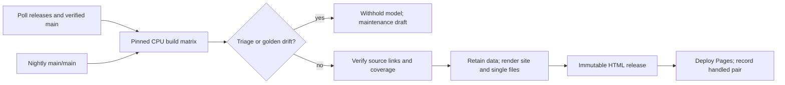

# CI and release automation

The workflows use GitHub-hosted Ubuntu CPU runners. Only the manually dispatched
`calibrate.yml` uses an NPU. Normal builds stay offline with respect to Hugging Face:
configs come from the catalog, tensors use meta devices, and weights are never downloaded.

| Workflow | Trigger | Result |
| --- | --- | --- |
| `ci.yml` | PRs; pushes except `state` | Lint, Python tests excluding `extract`, Node tests, schema drift, golden checks, and workflow/helper validation |
| `poll.yml` | `17 */6 * * *` UTC; manual | Discover declared compatible pairs and dispatch pinned builds |
| `build.yml` | Dispatch; reusable workflow call | Build every catalog model × device, isolate triage, retain snapshots, publish HTML releases and Pages |
| `nightly.yml` | `43 2 * * *` UTC; manual | Test the actual main/main heads through the reusable build, with publication disabled |
| `draft-pr.yml` | Dispatch from a triaged build; manual replay | Apply the maintenance skill, validate a rules/annotations-only diff, open a draft labeled `needs-review` |
| `calibrate.yml` | Manual on the default branch | Start the provisioned A2 runtime and upload logs from `calibration/` |



Nightly stops after collecting results and dispatching maintenance when actionable
triage exists. Main/main may be incompatible; its purpose is to expose that breakage.
Published main snapshots use vllm-ascend's **verified** vLLM commit instead.

## Repository setup

Enable Actions and choose **GitHub Actions** as the Pages source. The `github-pages`
environment must allow deployment from the default branch. Create a `calibration`
environment and provision a trusted Linux runner labeled `ascend-a2` with CANN,
torch-npu, compatible vLLM/vllm-ascend packages, and local model weights. Calibration
does not install or upgrade that runtime. Restrict that runner to trusted workflows.

Maintenance requires `ANTHROPIC_API_KEY` and `MAINTENANCE_TOKEN`. The latter is a
fine-grained PAT or an externally provisioned GitHub App token with contents,
pull-request, and issue write access to this repository. It is used only after the
agent and validation steps, to push the draft and manage its label/PR. An App token
must be refreshed by the installation's token provider. An ordinary `GITHUB_TOKEN`
would suppress CI events on the resulting PR, so there is no fallback to it.
The Claude action receives the job's read-only GitHub token, not the maintenance token.

Polling needs `actions: write`; publication needs `contents: write`, `pages: write`
and `id-token: write`. Neither PR CI nor CPU extraction receives a write credential.
Publication and maintenance dispatch are restricted to the default branch.

Commit `pnpm-lock.yaml` and `generator/uv.lock` before enabling the workflows. Setup
uses frozen/locked installs, Node 22, Python 3.12, uv's download cache and pnpm's store
cache. GitHub jobs use public PyPI/npm/PyTorch indexes, including an explicit override
of the local mirror default in `justfile`.

`generator/pyproject.toml` declares PyPI as its default uv index. The committed lock
uses `https://pypi.org/simple` and canonical `files.pythonhosted.org` artifacts;
package versions and dependency requirements are unchanged by the index migration.
Use PyPI when validating or updating that lock:

```sh
env -u UV_INDEX_URL -u UV_DEFAULT_INDEX uv sync --project generator --locked --index-url https://pypi.org/simple
env -u UV_INDEX_URL -u UV_DEFAULT_INDEX uv lock --project generator --index-url https://pypi.org/simple
```

For local mirror installs into an existing environment, `uv pip` does not rewrite the
project lock. Use the mirror for the experiment/bootstrap or a dedicated environment:

```sh
UV_INDEX_URL=https://mirrors.aliyun.com/pypi/simple/ uv pip install --python .cache/checks/bin/python pytest ruff
```

`uv sync --project generator --frozen` and `uv run --project generator --frozen ...`
also leave the lock untouched, but install the artifact URLs already in it; setting
`UV_INDEX_URL` does not redirect those locked URLs to a mirror. Do not run a resolving
`uv lock`/`uv sync --locked` with the mirror override: a different index changes the
resolution identity. The mirror default in `justfile` must be overridden with
`just --set UV_INDEX_URL https://pypi.org/simple/ ...` for resolving project commands.

All third-party `uses:` references, including those in composite actions, are full
commit SHAs with exact `# vX.Y.Z` comments. Pins were resolved from release tags using
`gh api repos/<owner>/<repo>/git/ref/tags/<tag>`; annotated tag objects were followed
through `git/tags/<sha>` until the object was a commit. Repeat that lookup when updating
a pin; retain the full SHA and version comment together.

## Pair discovery and state

The `state` branch is the durable release ledger and retained public data store:

```text
state.json
data/<snapshot-id>/<catalog-model-id>/<device>/{ir,view,report}.json
```

`state.json` is sorted JSON with a `pairs` object. Its keys are SHA-256 of compact,
sorted JSON `{"ascend":"<40-char-sha>","vllm":"<40-char-sha>"}`. Each handled
entry records `snapshot`, `generator` (the InferAtlas commit), and `blocked_models`.
Hard failures live separately at `failures[<pair-key>][<generator-commit>] = true`,
preserving any prior successful entry and its data. Old ledgers without `failures`
remain valid.
There are no timestamps in the ledger or generated manifests. The branch is created
on the first successful publication/triage handling or recorded hard failure; an existing branch missing its
ledger is an error. Do not force-push or independently write this branch.

Polling paginates both upstream repositories' releases APIs, including prereleases
and excluding drafts. `.github/actions/poll-config.json` sets `minimum_ascend_version`
to **0.30.0**, the current stable Ascend release confirmed through GitHub's releases API.
Releases below that floor
are excluded before reading their commits/pairing declarations. Versions compare
numerically; a prerelease of the minimum stable version is below the floor, while
prereleases of later versions remain eligible. Verified main is always considered.
For each eligible vllm-ascend release, it resolves the tag to a full SHA
and reads `.github/vllm-release-tag.commit` **at that SHA**. The declared vLLM tag must
also be a published vLLM release. Unpaired vLLM releases wait for an ascend declaration;
there is no tag Cartesian product. Older ascend releases without the declaration are
reported and skipped. For ascend main, polling resolves its head once and reads
`.github/vllm-main-verified.commit` at that immutable revision. API failures other than
missing historical declarations fail the poll rather than dropping candidates.

Each poll dispatches **at most one pair** to `build.yml` on the default branch, with
release pairs first in ascending numeric tag order, followed by verified main.
Duplicate commit pairs retain their first release label. It waits if any build on that
branch is queued, running, or waiting for execution/approval. Backfill therefore advances
across polls without replacing pending publication jobs. A dispatch alone never marks
a pair handled.

An always-evaluated failure job records hard plan, extraction, collection, release,
or deployment failures for publication-enabled default-branch runs. Polling resolves
the current default-branch SHA and suppresses pairs with a failure at that SHA; they
become eligible again only when that SHA changes. Diagnostic/nightly builds and
cancelled runs do not change the ledger. If the ledger write itself fails, the next
poll cannot see that failure and can retry; the failed writer is visible in Actions.

A successful partial publication records blocked model IDs, so unresolved triage
does not repeatedly spend agent credits. Entries with non-empty `blocked_models`
become eligible when the `rules/` or `annotations/` Git tree differs from the entry's
`generator` commit. This implements design §5.5's reviewed maintenance → rebuild loop
on the next poll. Docs-only and unrelated code changes do not trigger triage retries;
a hard failure at the current SHA takes precedence over maintenance retries.

Publication and hard-failure recording use the repository-wide `inferatlas-pages`
concurrency group. Each writer
restores the latest `state` branch before merging new public JSON and regenerating the
whole site. Old snapshots survive subsequent deployments; differing bytes at an existing
snapshot path are rejected. GitHub keeps only one pending job per concurrency group,
so manually dispatched bursts can still replace pending jobs. Polling's single dispatch
and active-build check avoid creating such bursts. Replaced runs have no ledger entry
and remain eligible. State pushes use ordinary fast-forward checks, never force pushes.

## Build and publication gates

The catalog is expanded dynamically, sorted by model ID then device ID. No layer counts,
intermediate sizes or device list are duplicated in workflow code. Duplicate/unsafe IDs
and matrices above GitHub's 256-job limit fail explicitly.

Each matrix job checks out both full upstream SHAs with depth one. The extraction
interpreter lives in `.cache/extract-venv/`; `INFERATLAS_SRC` points to `.cache/upstream`
and `INFERATLAS_PY` to its Python executable. The CPU bootstrap follows
`experiments/a2_qwen3moe/run.sh`: read ascend's torch/torchvision/torchaudio pins, constrain
all installed torch wheels to `+cpu`, use the PyTorch CPU index, install vLLM's
`requirements/common.txt`, and add its source directory through a `.pth` file. It never
builds/installs vLLM or installs torch-npu/triton-ascend. Ascend's optional CPU-compatible
requirements are attempted individually, with failures reported and listed under
`.cache/cpu-deps/skipped.txt`. Mandatory installs and the torch/vLLM import smoke check
fail normally. A changed/missing torch pin fails instead of selecting a guessed version.
Upstream mock loading and process isolation remain the extractor's responsibility.

The CLI boundary consumed by the workflows is:

```sh
uv run --project generator inferatlas build --model "$HF_ID" --device "$DEVICE" --out "$CELL_DIR"
uv run --project generator inferatlas verify --input "$CELL_DIR"
uv run --project generator inferatlas golden check --input "$CELL_DIR"
uv run --project generator inferatlas site --input .cache/state/data --out dist
```

CI also runs `inferatlas golden check` without `--input` for committed goldens.
These integration requirements are recorded in `docs/requests/T7.md`; the remaining
CLI/site implementation is supplied by the other tasks.

`build` must honor the checked-out SHAs and `INFERATLAS_{VLLM,ASCEND}_{COMMIT,TAG}`
environment values; `--out` must contain `triage.json` even for a coverage failure.
Successful output also contains schema-valid `ir.json`, `view.json` and `report.json`.
The wrapper checks upstream commits, catalog config revision, HF ID and device against
the produced snapshot. Fixture fallback or the wrong pairing cannot pass by accident.
`verify` must produce passing `schema`, `coverage`, and `source_links` report checks.
Any failed check, missing required evidence, source-link failure or remaining golden
diff blocks publication. Calibration may explicitly be skipped.

Non-empty triage is an expected model-level failure. Golden command failure is converted
to a schema-valid `golden_diff` triage item with its log. If **any device** needs triage,
the entire model is withheld; other models continue. A failed command without actionable
triage, malformed output or missing cell artifact is a hard failure and blocks deployment.
All cell diagnostics are retained for 14 days. Collected artifacts keep public JSON under
`bundle/data` and actionable evidence under `bundle/triage`.

The site command must consume the retained data tree, generate `dist/site/` (including
its sorted version/model index), and emit one offline HTML per available cell at
`dist/single/<snapshot-id>/<model-id>--<device>.html`. It can delegate to `just site`
and `just single`/the corresponding web package scripts. Files for exactly the current
clean matrix are checked before creating the release.

A snapshot ID/release tag is `snapshot-<sha256>` of sorted JSON containing both upstream
SHAs and a `trees` map of committed Git object hashes for `generator/` (including
`generator/uv.lock`), `rules/`, `annotations/`, `catalog.yaml`, `packages/`, `web/`,
`schemas/`, `pnpm-lock.yaml`, and `.github/actions/`. Files use blob hashes; directories
use tree hashes. Missing paths use JSON `null`, supporting the scaffold before
rule/annotation tasks are merged.
Changing these inputs produces a new snapshot; docs-only commits retain the same ID.
The ledger still records the full generator commit for retry decisions. Release assets
are the single files plus a sorted `SHA256SUMS`. Uploads occur in a draft release, which
is published only when complete. A retry can repair a draft; a published release is
downloaded and compared byte-for-byte and is never overwritten. Release validation
precedes `actions/upload-pages-artifact` and `actions/deploy-pages`. Only after deployment
does the workflow update the ledger and retained JSON. If every model is triaged, it
records that outcome without deploying an empty site or creating an empty release.

## Maintenance and calibration

`draft-pr.yml` accepts a build/nightly run ID, verifies its workflow, default branch,
repository and trusted trigger, then downloads that run's `bundle`. It validates the
triage schema and checks out the single declared upstream pair for source inspection.
`anthropics/claude-code-action` reads `skills/inferatlas-maintain/SKILL.md` and drafts only
rule/annotation YAML. A deterministic guard rejects any other modified/untracked path,
symlinks, or schema-invalid YAML. Lint, CPU unit tests, Node tests and golden checks run
before a separate credential commits and opens the draft. The agent is instructed not
to author line numbers, measurements, golden files or claims of human review. Reviewers
must resolve `needs-review` reviewer fields, check formulas/anchors and rerun the pinned
build before merge/publication. Existing draft branches and human edits are preserved
on retries. If the skill cannot propose valid changes, no empty PR is created; evidence
and the action response remain available in the run.

Calibration is manual, serial and bound to the `calibration` environment. Supply a
catalog HF ID, an absolute path to preinstalled matching weights and TP in 1/2/4/8.
The workflow runs `vllm serve` with fixed profiling parameters on loopback, waits for
health, stops the process, and uploads startup/device/runtime logs and a sorted request
JSON under `calibration/` for 90 days, including failed starts. It never downloads
weights, publishes a site, or commits calibration data. Raw hardware logs contain
runtime-dependent measurements and may include upstream timestamps; they are evidence,
not deterministic snapshot inputs. Parsing/reviewing them into calibration JSON remains
the verifier/maintainer's task.

## Local validation and replay

Install actionlint 1.7.12 from its official release into ignored `.cache/tools/`, and put
ShellCheck and Pyflakes on `PATH` to enable actionlint's embedded-script checks:

```sh
.cache/tools/actionlint -config-file .github/actions/actionlint.yaml .github/workflows/*.yml
uv run --project generator ruff check --config generator/pyproject.toml .github/actions
uv run --project generator ruff format --check --config generator/pyproject.toml .github/actions
uv run --project generator pytest .github/actions/tests
node --test .github/actions/tests/*.test.cjs
```

The explicit `*.test.cjs` glob is required on Node 22; passing the tests directory as
the sole argument fails. The helper tests use mocks, real contract fixtures and local
Git repositories. They exercise failure suppression/retry, bounded backfill, maintenance
rebuilds, content-based snapshot identity, model-wide triage, report gates, release
immutability and state retention without GitHub writes, NPU access or weights.

Replay a known pair after integration, from a checkout of the default branch:

```sh
gh workflow run build.yml -f vllm_commit="$VLLM_SHA" -f ascend_commit="$ASCEND_SHA" \
  -f vllm_tag="$VLLM_TAG" -f ascend_tag="$ASCEND_TAG" -f publish=true
gh workflow run draft-pr.yml -f run_id="$BUILD_RUN_ID"
```

Use `-f publish=false` for a diagnostic build. Manual `poll.yml` and `nightly.yml`
dispatches need no inputs. These workflows must exist on the default branch before
scheduled/dispatch operation is available. Configure credentials and Pages on the
integrated repository before attempting a live deployment.

References: [GitHub reusable workflows](https://docs.github.com/en/actions/how-tos/sharing-automations/reuse-workflows),
[Claude action usage](https://github.com/anthropics/claude-code-action/blob/main/docs/usage.md),
[actionlint checks](https://github.com/rhysd/actionlint/blob/main/docs/checks.md).
